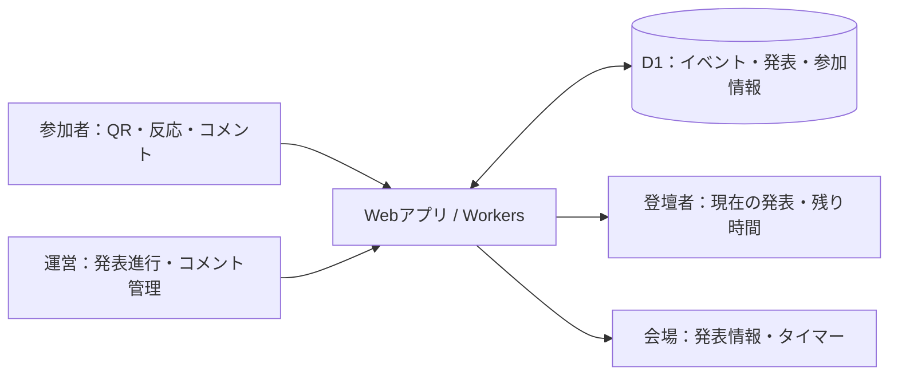

# Workshop Commons

## 会場を、ひとつのアプリに。

**参加はスマホ。登壇はPC。進行は運営。会場全体が、同じ発表を見つめる。**

QR参加、スマホとPCの接続、発表進行、同期タイマー、リアクション、コメント管理。Workshop Commonsは、LT会・勉強会・ハッカソンの「当日」を支えるイベント運営アプリです。

イベントの価値は、人が集まり、発表を聞き、反応を返す時間にあります。ところが当日の現場では、登録フォーム、タイマー、会場案内、質問用チャットの切替がその時間を奪います。

目指すのは、運営がツールの切替に追われず、参加者が次の行動に迷わず、登壇者が発表に集中できる会場。**AIを使ってアプリを作り、人が集まる体験を支える。** それがこの作品のテーマです。専用アプリのインストールは不要です。

[公開アプリ](https://workshop-commons-main-oct18.yamichi.chatgpt.site) · [開発・運営ガイド](docs/development.md)

DevDay Community Hackathon（2026年10月18日）の成果物です。[公式Lumaページ](https://luma.com/OpenAIDevDay2026CommunityHackathonTokyo)の4つの審査観点に沿って、課題・解決方法・実装の根拠を以下にまとめています。

## この作品の核心

**受付フォーム・タイマー・チャットを別々に開く運営から、参加と進行がつながる会場へ。**

想定する利用場面は、LT会、社内勉強会、ハッカソンの成果発表です。

| 使う人 | 現場での困りごと | 今回実装した解決方法 | 実装の入口 |
| --- | --- | --- | --- |
| 初めての参加者 | 到着後、どのリンクを開くか迷う | 会場QRからニックネームで参加。登録後に会場・ライブ等のメニューを表示 | [ホーム](src/components/dashboard.tsx)、[共通ナビ](src/components/workspace.tsx) |
| スマホとPCを使う参加者 | 端末を変えると参加情報が分かれる | スマホでPCの接続を確認し、同じプロフィールを共有。端末ごとに解除可能 | [参加・端末接続](src/server/participation.ts) |
| 運営・登壇者・会場の観客 | 発表の切替やタイマーの状態が食い違う | 共通のLT状態とサーバー時刻を参照し、役割別に表示 | [LTサーバー](src/server/lt.ts)、[役割別画面](src/components/lt.tsx) |
| 発表を聞く参加者 | 質問が埋もれる、発表の切替中に誤送信する | 発表別のコメントと4種類の反応。切替中も下書きの投稿対象を保持 | [交流画面](src/features/engagement/EngagementPage.tsx) |
| コメントを管理する運営 | 進行とコメント対応を別々に管理する | 共通の運営権限で、受付停止・再開・コメント非表示を操作 | [交流API](src/features/engagement/server.ts) |

### ひとつのイベント、4つの視点

参加者にはスマホで押しやすいメニュー、登壇者には発表と残り時間、運営には進行操作、会場には大きな発表表示。**同じ進行状態を、それぞれに必要な形で届けます。**

例えば当日の流れは、QRで参加 → スマホでPC接続を承認 → 運営が発表開始 → 登壇者と会場が同じ進行を確認 → 観客がその発表へ反応、という一続きの体験です。参加登録と交流投稿のセッションは別管理で、全機能の本人IDを自動統合する構成ではありません。

## 1. 新機能の活用：ChatGPT SpaceとGPT-6.1 Solで、企画から提出までつなぐ

**DevDay 2026発表のChatGPT Spaceで企画と仕様を共有し、GPT-6.1 SolをCodexで実装の読解・提出資料の編集・エージェントによるレビューに使用。** コードの機能を並べるだけでなく、利用者の課題、設計の意図、実装の根拠を結び付ける工程を新モデルと進めました。

[OpenAIのDevDay 2026公式発表](https://learn.chatgpt.com/docs/whats-new/devday-2026#api)はGPT-6.1 Solを発表機能として紹介し、[Codexのモデル案内](https://learn.chatgpt.com/docs/models#gpt-61-sol)はCodexでの利用を案内しています。今回の資料作成セッションでは、モデル設定が `gpt-6.1-sol` であることを確認しています。

### ChatGPT Space：チームの企画と仕様を、共同で扱える場所へ

チームの「devdayハッカソン」Spaceに、製品の概要、当日やること、審査ルール、新機能の調査を集約しました。「製品の概要（目指すところ）」では4つの役割・画面・共通データ・優先順位を整理し、「今日やること」ではQR登録とスマホ・PC接続等を作業案に落とし込んでいます。

当日の共有記録には、Google DocsからSpaceへ共有を集約する方針も残っています。チャットに流れるアイデアを、チームで読み直せる仕様と作業の土台にする使い方です。元の仕様には将来構想も含まれるため、このREADMEでは実装済みの範囲をコードと照合して紹介しています。

**Spaceで考えを揃え、Codexで実装し、ImageGenで世界観を作り、Sitesで公開する。** その成果をGPT-6.1 Solでコードと照合し、第三者がGitHubから理解できる提出物に仕上げています。

Codexによる開発の成果は、画面に加えて、永続化、状態遷移、競合制御、運営権限、APIテストまで含むアプリの構成です。ImageGenでは選択したデザインを参照して素材を生成し、共通の画面デザインに組み込みました。Sitesの公開準備では、静的ファイルに加えてWorkerとD1マイグレーションをまとめ、ローカルのシークレットを取り除きます。

| 利用したもの | この成果物での役割 | GitHubで確認できる成果 |
| --- | --- | --- |
| **ChatGPT Space（DevDay 2026発表）** | 製品概要・当日タスク・ルール・新機能の情報を共有し、企画を仕様と作業へ整理 | [制作時の利用記録](docs/development.md#chatgpt-spaceの利用) |
| **GPT-6.1 Sol in Codex（DevDay 2026発表）** | 提出資料の構成・コード照合・レビュー。複数ファイルを横断して、体験・設計・検証を対応付け | [このREADME](README.md)、[開発・検証ガイド](docs/development.md)、[PR #32](https://github.com/itsuki-abe/event-management-service/pull/32) |
| Codex | 参加・端末接続・LT進行・交流を実装し、GitHubで統合 | [ソース](src/)、[変更履歴](https://github.com/itsuki-abe/event-management-service/commits/main/) |
| ChatGPT Sites | Worker・静的アセット・D1マイグレーションを公開用にまとめる | [公開準備処理](scripts/prepare-sites.mjs)、[公開先設定](.openai/hosting.json) |
| ImageGen | 共通の配色・デザインに合わせたイラストとアバターを制作 | [同梱素材と生成方法](public/assets/commons/README.md) |

### 新モデルを使う目的と、得られた改善

審査者がGitHubだけを読む場合、動くコードがあっても、その価値が自動で伝わるとは限りません。そこでGPT-6.1 Solには、参加・進行・交流の実装を読み、現場の体験へ翻訳する役割を持たせました。

- **実装の関係を説明する：** 参加者・運営・登壇者・会場の4役割を図示し、各体験から該当コードへ直接たどれる構成に整理。
- **主張とコードを照合する：** 参加登録と交流投稿が別セッションである点、コメントの入力保持と再読込後の復元が異なる点をレビューで確認し、説明を正確化。
- **成果物をレビュー可能にする：** 開発手順を分離し、実装済み機能と今後の拡張、実行済み検証と確認用スクリプトの範囲を整理。

Spaceと新モデルの活用先は企画・制作・提出工程です。利用者向けアプリには推論APIを組み込まず、参加・進行・交流そのものは保存済みデータと通常のWeb処理で動かします。ImageGenとSitesの利用は制作全体の説明であり、それら自体を今回のDevDay新機能と断定していません。

## 2. 使いやすさ：「次に何をするか」が分かる

**初回に必要なのは、参加すること。** ホームではスマホ登録用のQRと直接登録への導線を中心にし、登録前から多数のメニューを見せない構成です。登録後はスマホで固定の下部4タブ、PCで上部ナビゲーションと2カラムへ切り替わります。会場案内は公開データだけを表示し、未設定のWi-Fiやチーム情報を架空のデータで埋めません。

| 体験の工夫 | 利用者への効果 | 根拠 |
| --- | --- | --- |
| QRと短いプロフィールで参加 | 受付から参加者用画面へ進める | [参加画面](src/components/participation.tsx)、[参加API](src/server/participation.ts) |
| PC接続は登録済みスマホで明示確認 | URLを開いただけで接続されず、本人が接続先を確認できる | [接続処理](src/server/participation.ts) |
| 「次の発表へ」で自動開始しない・開始前へ戻せる | 準備時間と発表時間を分け、誤操作を修正できる | [LT操作](src/server/lt.ts)、[運営UI](src/components/lt.tsx) |
| 発表が切り替わっても下書きの対象を維持 | 書いていた質問を意図しない発表に送ることを避ける | [交流UI](src/features/engagement/EngagementPage.tsx) |
| 通信失敗時の再接続・コメント入力保持 | LTは再読込後に共有状態を取得し、コメントは送信失敗時に入力を保持 | [LT画面](src/components/lt.tsx)、[交流UI](src/features/engagement/EngagementPage.tsx) |

書体・アイコンはローカル配信し、ホーム・会場案内・ライブ・運営で共通のナビゲーションとデザインを使っています。[共通シェル](src/components/workspace.tsx)、[共通スタイル](src/workspace.css)から確認できます。

## 3. 有用性：進行の手間を、参加の時間へ

LT会・社内勉強会・成果発表。テーマが変わっても、「参加する」「発表する」「進める」「反応する」という会場の行動は繰り返されます。その繰り返し使える部分を、ひとつのアプリにまとめました。

| 利用場面 | 使える機能 | 運用上の価値 |
| --- | --- | --- |
| LT会・社内勉強会 | 発表順、開始・停止・再開、登壇者・会場画面 | 段取りと表示を同じ進行状態から扱える |
| ハッカソンの成果発表 | QR参加、PC接続、役割別表示 | 会場参加と発表準備を同じWebアプリで進められる |
| 質疑・参加型セッション | 発表別コメント、4種類の反応、受付制御 | 発表ごとに声を集め、運営が管理できる |

**当日への備えも、実装の一部です。**

- **進行を復元できる：** タイマーは経過秒・再開時刻・状態をD1に保存。画面側で残り時間を計算し、毎秒DBへ書き込みません。再読込後も保存済み状態を取得します。[時間計算](src/lib/lt.ts)、[永続化と進行処理](src/server/lt.ts)。
- **複数の運営者による食い違いに対応する：** イベント内で動く発表は1件に制限し、古い状態を元にした競合操作は最新状態での再操作を求めます。[LT処理](src/server/lt.ts)、[DB制約](src/db/schema.ts)。
- **参加者と運営の操作を分ける：** 参加者の自己登録で運営権限を付与せず、進行とコメント管理には運営用Cookieを要求します。[運営認証](src/server/organizer.ts)、[参加処理](src/server/participation.ts)。
- **イベントを跨ぐ紐付けを防ぐ：** 発表者・コメント・リアクション等のイベント一致を複合外部キーで検証します。[共通スキーマ](src/db/schema.ts)。

同期はポーリング方式です。LT専用画面は約1.5秒、交流画面は約2秒、ホームは約5秒間隔で取得します。負担軽減はこの機能構成から期待する価値で、削減時間や参加率は未測定です。

## 4. 独創性：端末ではなく、参加者を中心に考える

**ひとりの参加者が、ずっと同じ端末・同じ役割で過ごすとは限らない。** ここを出発点にしました。着眼点は、「スマホで参加し、PCで登壇する」当日の端末・役割の切替です。スマホで参加を済ませ、PCの接続QRをスマホで確認することで、同じ参加者として複数端末を使えます。登壇者と会場には、それぞれ専用の発表・タイマー表示を用意しました。

受付フォーム・タイマー・チャットを別々に使う場合と比べ、イベント・発表・参加者の関係をひとつのモデルで持つことが解決方法の特徴です。例えば、コメントは発表に、端末は参加者に、進行状態はイベントに紐付きます。機能の数だけでなく、役割が変わっても参加状態と進行状況をつなぐ構成を重視しています。

端末接続コードは5分間・一度限り有効で、DBにはコードとセッショントークンのハッシュを保存します。スマホで確定するまでPCを未接続に保ち、接続解除後の端末利用も拒否します。この接続の境界は[自動テスト](src/server/participation.test.js)で確認しています。**会場で人が端末と役割を切り替える瞬間を、設計の中心に置いたこと**が、この作品の独自の着眼点です。

## 実装範囲

| 状態 | 機能 |
| --- | --- |
| 実装済み | 参加登録・プロフィール編集・QR・端末ペアリング・端末解除・公開会場案内 |
| 実装済み | 発表登録・編集・順番変更・LT進行・同期タイマー・登壇者／会場表示 |
| 実装済み | 4種類のリアクション・発表別コメント・受付停止／再開・コメント非表示 |
| 表示のみ | チーム画面は未案内表示。チーム編成・所属管理は未実装 |
| 設定保存のみ | コメントの投影許可。会場スクリーンへのコメント表示は未接続 |
| 未実装 | WebRTC画面共有・スライド配信・マッチング・アプリ内の推論API利用 |

会場スクリーンは発表情報とタイマーを表示します。

## コードで確認できる体験の裏付け

**資料の初回更新時に、参加・端末接続APIの12テスト・84アサーションが成功。** 正常に接続できるだけでなく、本人が意図した接続だけが成立する境界まで確認しています。

| 実現したい体験 | 自動テストで確認したこと |
| --- | --- |
| 接続するPCを自分で選ぶ | スマホで明示確定するまでPCは未接続。確定後に同じプロフィールを共有 |
| 同じ接続コードを奪い合わない | 同時に同じPCへ接続しても一方だけが成功。再発行前・期限切れコードは拒否 |
| 端末を手放したら接続を切る | 他人の端末解除は拒否。解除後の端末は復元・更新・コード利用不可 |

[テスト本体](src/server/participation.test.js)から条件と結果を追えます。公開先のDB接続成功も確認済みです。LT操作・交流API・ブラウザー同期のスクリプトを同梱し、実行済みの範囲と再現手順を[検証記録](docs/development.md#2026年10月18日の確認記録)にまとめています。上記テストはAPIの検証で、実機・利用者評価を示すものではありません。

## 技術構成と開発資料

TanStack Start / React / TypeScript、Cloudflare Workers / D1、Drizzle ORM、Bunで構成しています。QRは `qrcode.react`、フォントとアイコンはローカル配信です。

[開発・運営ガイド](docs/development.md)に、ローカル起動、画面のURL、運営認証、API、スキーマ、テスト、公開手順をまとめています。
